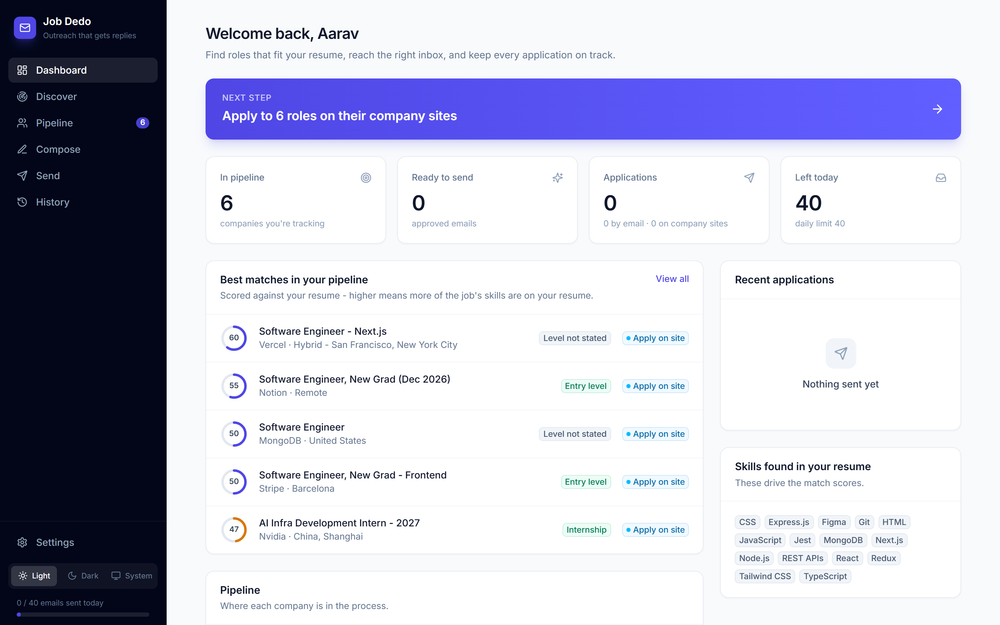
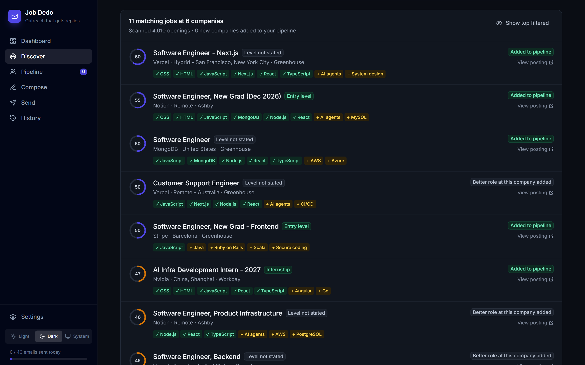
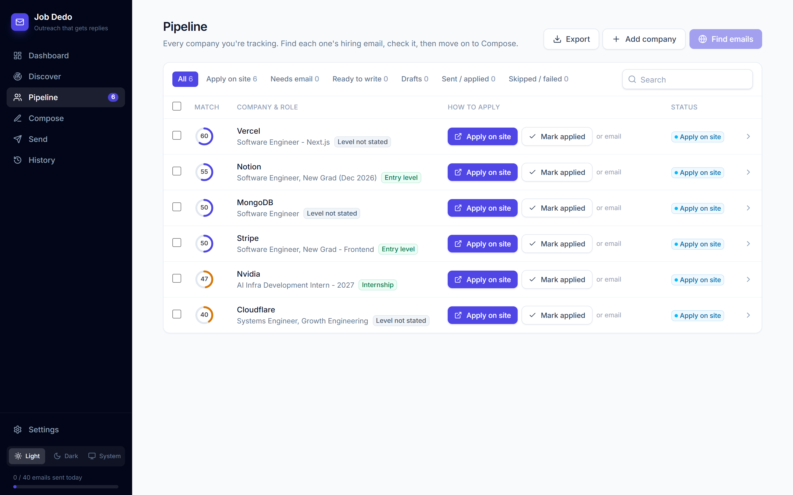

# 📨 Job Dedo

Find jobs that actually fit your resume, reach the right inbox, and keep every application on track.



<table>
  <tr>
    <td></td>
    <td></td>
  </tr>
  <tr>
    <td align="center"><sub>Discover: every opening scored against your resume (dark theme)</sub></td>
    <td align="center"><sub>Pipeline: apply on site, or find the hiring email</sub></td>
  </tr>
</table>

<sub>Screenshots use a fictional demo profile (a frontend developer) and real public job postings.</sub>

1. **Discovers jobs at the source.** It scans company career pages directly through the public job feeds of 8 hiring systems (Greenhouse, Lever, Ashby, Workable, SmartRecruiters, Workday, Recruitee, Personio), finds new companies by searching the web for their job pages, imports the jobs from your LinkedIn / Naukri / Indeed / Internshala / Glassdoor alert emails, and searches job boards.
2. **Scores every job against your resume.** It shows a match score, the skills you have (✓) and the ones the posting asks for that you don't (+), and the seniority level. Roles that don't fit are filtered out, and freshers can hide anything asking for 2+ years.
3. **Picks the right way to apply.** Jobs from a company's own board get an **Apply on site** link and a *Mark applied* button. For everything else it finds the hiring email (`careers@`, `hiring@`, `jobs@`…) on the company's website.
4. **Writes the email.** Start from your own template or let an AI model (Claude, OpenAI, Gemini, or any OpenAI-compatible model like Groq/OpenRouter/Ollama) draft one from your resume and the posting, then tailor each one.
5. **Sends it from your Gmail** with your resume attached, after you've reviewed it, with pauses between emails so your account isn't flagged.

Everything runs on your own computer. Your keys, resume and contacts never leave it, except to the APIs you choose.

---

## Quick start

Needs **Python 3.10+** and **Node.js 18+** (Node is only needed for the one-time build of the web app).

```bash
git clone https://github.com/<your-username>/job-dedo.git
cd job-dedo

python -m venv .venv
# Windows:      .venv\Scripts\activate
# macOS/Linux:  source .venv/bin/activate
pip install -r requirements.txt

cd web && npm install && npm run build && cd ..   # once, and again after pulling UI changes

python run.py
```

The app opens at **http://localhost:8000**. Start on **Settings**, then follow the *Next step* banner on the Dashboard.

## How it works

| Page | What you do |
|---|---|
| **Settings** | Profile, resume (its skills drive match scores), Gmail App Password, optional AI and job-board keys |
| **Discover** | *Career pages:* build a watchlist (starter list, paste a careers link, or **Find more companies on the web**) and scan it. *Job boards:* search Remotive, RemoteOK, Arbeitnow, Adzuna, Jooble and JSearch. *Job alerts:* import the jobs from your alert emails. Only matching roles are added to your pipeline. |
| **Pipeline** | Every company you track. *Apply on site* for portal jobs, *Find emails* for the rest, and you can fix any address inline. |
| **Compose** | Draft from a template or with AI, then edit each email with the job's skills shown beside it. Approve when it's ready. |
| **Send** | Send yourself a test, confirm, and send. A live countdown runs between emails and you can stop at any time. |
| **History** | Everything you've sent. Applications older than a week are flagged so you know when to follow up. |

### Match score

`score = 60% skill overlap + 40% role relevance`

- **Skill overlap:** of the ~170 known skills (web, backend, mobile, data, ML/AI, security, DevOps, testing, design, product, marketing) the posting mentions, the share that also appear on your resume. Postings that name only a couple of skills count for less.
- **Role relevance:** full marks if one of your keywords is in the job title, partial if several appear in the description. Keywords are suggested from your target role (e.g. "Web Developer Intern" → web developer, frontend, react, javascript…) and you can edit them on Discover.
- **Level:** read from the title (intern, junior, senior…) and phrases like "3+ years". *Fresher-friendly only* hides mid-level and senior roles. Internships always pass if the skills fit.

## What you need

| What | Required? | Where to get it |
|---|---|---|
| Your resume (PDF/DOCX) | ✅ | - |
| Gmail **App Password** | ✅ to send email | Turn on 2-Step Verification, then [myaccount.google.com/apppasswords](https://myaccount.google.com/apppasswords) |
| AI API key | Only for AI-written drafts | [Anthropic](https://console.anthropic.com/settings/keys) · [OpenAI](https://platform.openai.com/api-keys) · [Gemini](https://aistudio.google.com/apikey) (free tier) · [Groq](https://console.groq.com/keys) (free tier) |
| Adzuna key | Optional, city-level jobs in 19 countries | [developer.adzuna.com](https://developer.adzuna.com/) (free) |
| Jooble key | Optional, worldwide jobs | [jooble.org/api/about](https://jooble.org/api/about) (free) |
| JSearch key | Optional, LinkedIn/Indeed/Glassdoor listings via Google for Jobs | [rapidapi.com → JSearch](https://rapidapi.com/letscrape-6bRBa3QguO5/api/jsearch) (free tier) |

## Job sources

| Source | Key | Coverage |
|---|---|---|
| **Career pages**: Greenhouse, Lever, Ashby, Workable, SmartRecruiters, Workday, Recruitee, Personio | none | Every open job at the companies on your watchlist, read from each system's public job feed. For very large employers (Workday, SmartRecruiters) only postings matching your keywords are read in full |
| **Web discovery** | none | `site:` searches (DuckDuckGo, falling back to Bing and Yahoo) across those 8 systems' domains for your keywords; finds companies to add to the watchlist |
| **Job-alert emails**: LinkedIn, Naukri, Indeed, Internshala, Glassdoor | your Gmail App Password | Reads your alert emails over IMAP (read-only) and extracts each job's title, company and link; the job sites themselves are never visited |
| Remotive, RemoteOK | none | Remote jobs |
| Arbeitnow | none | Europe + remote |
| Adzuna | free | 19 countries incl. India, US, UK; collects many Indeed- and Naukri-type listings |
| Jooble | free | Worldwide aggregator |
| JSearch (RapidAPI) | free tier | Google for Jobs results, which include LinkedIn, Indeed and Glassdoor postings |

What it deliberately doesn't do: log into LinkedIn or Naukri, scrape them, or auto-submit application forms. That breaks those sites' terms and gets accounts banned. You apply on company sites yourself, using the direct link.

## Sending responsibly

- **Daily cap**, 40 by default (Gmail's hard limit is ~500).
- **Random pause** between emails (45–120 s by default).
- **Nothing is sent until you approve it**, and you can send yourself a test first.
- **Never emails the same address twice.**
- **One tailored email per company**, not a mass blast.

Write to hiring addresses, keep each email relevant to the company, and stop if someone asks you to. In some places, unsolicited email is regulated (e.g. CAN-SPAM in the US, GDPR in the EU), so you are responsible for how you use this tool.

## Development

Set `JOB_DEDO_DATA_DIR` to run with a separate data folder (e.g. a demo profile) without touching your own `data/`.

```bash
python run.py --reload --no-browser   # API on :8000, restarts on Python changes
cd web && npm run dev                 # UI on :5173 with hot reload, proxies /api to :8000
```

API docs: http://localhost:8000/api/docs

## Project layout

```
run.py                     Starts the server and opens the browser
job_applier/
  api.py                   FastAPI REST API + serves the built web app
  tasks.py                 Background tasks (scans, lookups, paced sending) with progress
  ats.py                   Career-page scanner: Greenhouse / Lever / Ashby / Workable / SmartRecruiters / Workday / Recruitee / Personio
  discovery.py             Finds new company job boards with site: web searches
  alerts.py                Imports jobs from LinkedIn / Naukri / Indeed / Internshala / Glassdoor alert emails (Gmail IMAP, read-only)
  matcher.py               Resume ↔ job match score, skills gap, seniority
  job_sources.py           Remotive / RemoteOK / Arbeitnow / Adzuna / Jooble / JSearch clients
  scraper.py               Company website lookup, email + careers-page extraction
  writer.py                Templates + Claude / OpenAI / Gemini / OpenAI-compatible writers
  mailer.py                SMTP sending with the resume attached
  storage.py               SQLite (data/job_applier.db): companies, watchlist, sent log
  settings.py              Profile (data/profile.json) and keys (.env)
  resume.py                Resume text extraction
web/                       React + TypeScript + Tailwind UI (Vite)
```

`data/`, `.env` and `guide/` are git-ignored, so your personal data is never committed.
